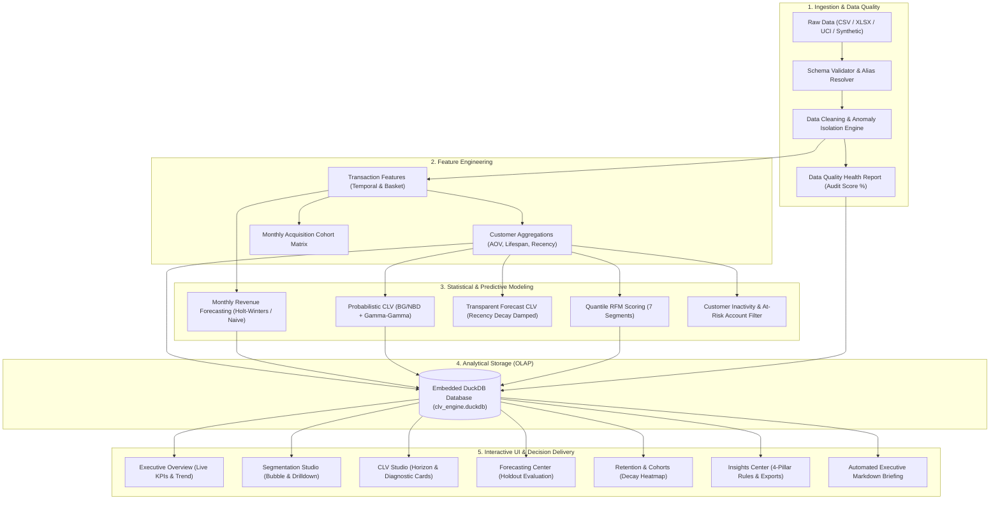
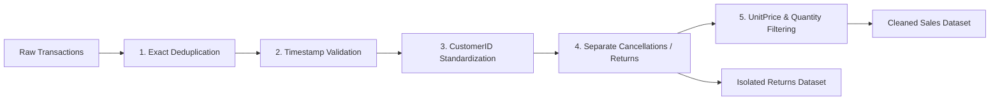
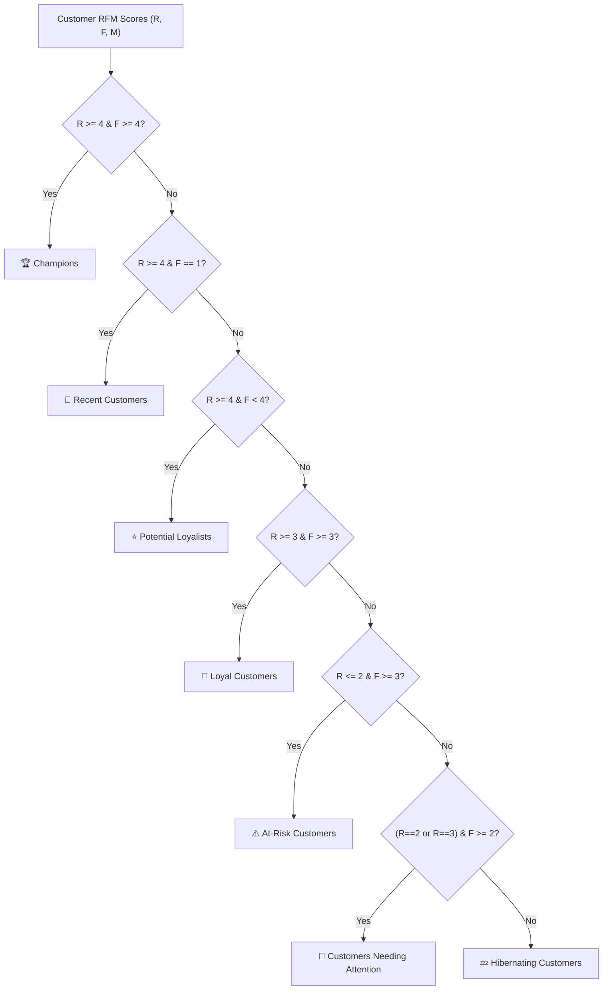
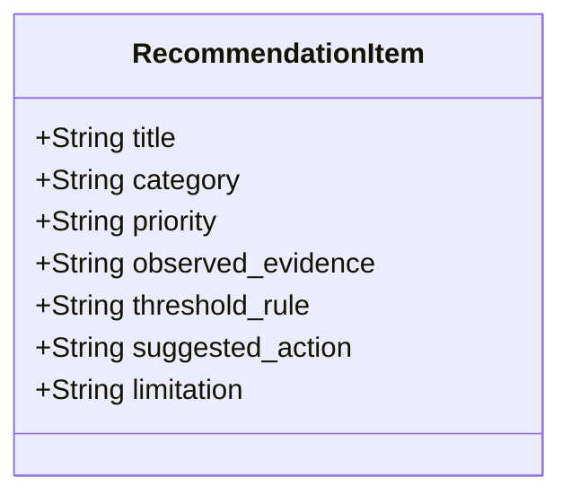

# Customer Lifetime Value (CLV) & Revenue Forecasting Engine

[](https://www.python.org/)
[](https://duckdb.org/)
[](https://streamlit.io/)
[](https://github.com/CamDavidsonPilon/lifetimes)
[](https://www.statsmodels.org/)
[-brightgreen?logo=pytest&logoColor=white)](tests/)
[](.github/workflows/ci.yml)
[](LICENSE)

An end-to-end, production-grade business intelligence and predictive analytics platform that transforms granular transaction data into customer-level behavioral profiles, RFM segments, Customer Lifetime Value (CLV) estimates, aggregate monthly revenue projections, and rule-based business recommendations.

> [!NOTE]
> **Zero Cloud Dependencies:** Operates entirely locally on Ubuntu Linux (or any standard Linux/macOS environment) with **0 Docker containers**, **0 paid APIs**, and **0 external cloud services** using an embedded **DuckDB** analytical store.

---

## Table of Contents

- [1. Business Problem & Executive Summary](#1-business-problem--executive-summary)
- [2. System Architecture](#2-system-architecture)
- [3. Key Platform Capabilities](#3-key-platform-capabilities)
- [4. Data Ingestion, Hygiene & Auditability](#4-data-ingestion-hygiene--auditability)
- [5. Analytical & Modeling Methodologies](#5-analytical--modeling-methodologies)
  - [A. RFM Behavioral Segmentation](#a-rfm-behavioral-segmentation)
  - [B. Customer Lifetime Value (CLV) Modeling](#b-customer-lifetime-value-clv-modeling)
  - [C. Time-Series Revenue Forecasting](#c-time-series-revenue-forecasting)
  - [D. Cohort Retention & Inactivity Lifecycle](#d-cohort-retention--inactivity-lifecycle)
  - [E. Rule-Based Recommendation Engine](#e-rule-based-recommendation-engine)
- [6. Interactive Dashboard Architecture (7 Pages)](#6-interactive-dashboard-architecture-7-pages)
- [7. Analytical Database Schema (DuckDB / SQLite)](#7-analytical-database-schema-duckdb--sqlite)
- [8. Installation & Quickstart](#8-installation--quickstart)
- [9. Automated Testing & Verification](#9-automated-testing--verification)
- [10. Engineering Highlights & Design Decisions](#10-engineering-highlights--design-decisions)
- [11. Known Limitations & Responsible Modeling](#11-known-limitations--responsible-modeling)

---

## 1. Business Problem & Executive Summary

Non-contractual commercial platforms (retail, e-commerce, wholesale) face five critical operational blind spots:
1. **Silent Attrition:** Customers do not cancel subscriptions; they quietly defect without notice.
2. **Revenue Concentration Risk:** The Pareto principle frequently concentrates over 50% of revenue in fewer than 10% of accounts.
3. **Flawed Single-Purchase Strategies:** Blanket marketing sequences waste margin on one-off buyers rather than fostering repeat buyer velocity.
4. **Uncertain Cash Flow Trajectories:** Teams struggle to forecast upcoming multi-month revenue without accounting for trend and seasonality.
5. **Black-Box Skepticism:** Predictive models without explicit assumption checks or transparent fallbacks fail business adoption.

This platform solves these challenges through a modular, reproducible data engineering and statistical modeling engine that bridges raw order logs and executive decision-making.

---

## 2. System Architecture



---

## 3. Key Platform Capabilities

| Capability | Implementation Details | Key Business Output |
| :--- | :--- | :--- |
| **Data Cleaning & DQ Audit** | Automated deduplication, return isolation (`is_return`), float-ID cleanup, invalid timestamp filtering. | Auditable Data Quality Health Score (`%`), clean sales separation. |
| **RFM Segmentation** | Percent-rank quantile scoring (1–5) with tie-handling across Recency, Frequency, Spend. | Classifies accounts into 7 actionable segments (*Champions*, *At-Risk*, etc.). |
| **Probabilistic CLV** | BG/NBD (transaction cadence) + Gamma-Gamma (monetary spend) with weekly time scaling. | 3, 6, 12-month expected transaction frequency, spend, and discounted net value. |
| **Transparent CLV Fallback** | Exponential recency decay $\exp(-\text{recency}/180)$ with margin and discount rate options. | Safe, mathematically transparent baseline when sample assumptions fail. |
| **Revenue Forecasting** | Chronological holdout evaluation comparing Naive, Seasonal-Naive, and Holt-Winters. | Forecasts future monthly revenue with defensible 95% prediction intervals. |
| **Cohort Retention** | Acquisition month vs. activity month normalized matrix. | Visualizes retention degradation curve and repeat purchase rate. |
| **Prescriptive Rules** | 4-part rule-based recommendation generator (Evidence, Trigger, Action, Limitation). | Actionable strategies without hardcoded or fabricated outcomes. |
| **Dual Database Support** | Native DuckDB storage with seamless SQLite fallback. | Serverless, zero-setup ACID/OLAP persistence. |

---

## 4. Data Ingestion, Hygiene & Auditability

The engine ingests data from three transparent avenues:
1. **Public Benchmark:** Official [UCI Machine Learning Repository: Online Retail Dataset](https://archive.ics.uci.edu/dataset/352/online+retail) containing non-store retail transactions.
2. **Deterministic Synthetic Generator:** Self-contained script (`scripts/generate_synthetic_data.py`) creating reproducible transactions with deliberate real-world anomalies (returns, missing customer IDs, price zeroes, duplicate orders).
3. **Custom Upload:** CSV or Excel upload through the dashboard with automated column alias mapping.

### Data Cleaning Policies



> [!IMPORTANT]
> **Data Quality Health Formula:**
> $$\text{DQ Health Score} = \left(\frac{\text{Cleaned Valid Sales Rows}}{\text{Total Raw Ingested Rows}}\right) \times 100$$
> Excluded records (guest checkouts without customer IDs, cancellation adjustments, unit price anomalies) are tracked transparently in the `data_quality_reports` database table.

---

## 5. Analytical & Modeling Methodologies

### A. RFM Behavioral Segmentation

To prevent quantile collapse when many customers place only one order, scoring uses rank percentiles:
- **Recency ($R$):** Days elapsed from last purchase to reference date. Inverted: lowest recency earns $R=5$.
- **Frequency ($F$):** Distinct completed invoices (not line items). Highest earns $F=5$.
- **Monetary ($M$):** Cumulative spend across all valid orders. Highest earns $M=5$.

#### Segment Assignment Rules



---

### B. Customer Lifetime Value (CLV) Modeling

The studio implements two complementary models and one historical benchmark:

#### 1. Probabilistic Model (BG/NBD + Gamma-Gamma)
- **Transaction Rate $\lambda$ & Dropout Probability $p$ (BG/NBD):**
  Models purchase frequency as a Poisson process with Gamma-distributed purchase rates, and churn as a Geometric process with Beta-distributed dropouts.
- **Monetary Value (Gamma-Gamma):**
  Models average spend per transaction with Gamma distribution.
- **Independence Check:** Validates Gamma-Gamma independence assumption via Pearson correlation test ($r \approx 0, p > 0.05$).
- **Weekly Time Scaling:** Recency and customer age $T$ are scaled to weeks to prevent numerical underflow in optimization:
  $$\text{recency\_weeks} = \frac{\text{recency\_days}}{7}, \quad T_{\text{weeks}} = \frac{T_{\text{days}}}{7}$$

#### 2. Transparent Forecast Baseline (Robust Fallback)
When repeat buyer counts are low ($< 10$) or optimization fails, the system automatically falls back to an interpretable analytical model with exponential recency decay damping:

$$\text{Activity Weight} = \exp\left(-\frac{\text{recency\_days}}{180}\right)$$

$$\text{Expected Orders} = \text{purchase\_frequency\_per\_month} \times \text{horizon\_months} \times \text{Activity Weight}$$

$$\text{Predicted CLV} = \frac{\text{Expected Orders} \times \text{AOV} \times \text{Gross Margin}}{1 + \text{Discount Rate} \times \left(\frac{\text{horizon\_months}}{12}\right)}$$

---

### C. Time-Series Revenue Forecasting

- **Strict Chronological Holdout Split:** Time-series observations are never randomly shuffled. The model trains on past months and evaluates on held-out recent months.
- **Evaluated Models:**
  1. **Naive Baseline:** Projects the last observed monthly revenue.
  2. **Seasonal-Naive:** Repeats observations from 12 months prior (requires $\ge 24$ months).
  3. **Holt-Winters Exponential Smoothing:** Captures level and additive trend with defensible 95% prediction intervals derived from residual variance:
     $$\hat{y}_{t+h} \pm 1.96 \cdot \sigma_{\text{residuals}}$$
- **Evaluation Metrics:**
  - **MAE:** Mean Absolute Error
  - **RMSE:** Root Mean Squared Error
  - **WAPE:** Weighted Absolute Percentage Error:
    $$\text{WAPE} = \frac{\sum_{t} |y_t - \hat{y}_t|}{\sum_{t} |y_t|} \times 100\%$$
  - **MAPE:** Mean Absolute Percentage Error (computed on non-zero actuals).

---

### D. Cohort Retention & Inactivity Lifecycle

- **Acquisition Cohort Matrix:** Tracks monthly retention decay across cohorts indexed from Month 0 to Month $N$.
- **Inactivity Buckets:** Categorizes accounts into five operational lifecycle stages:
  - `Active`: 0–30 days
  - `Cooling Down`: 31–90 days
  - `Warm Inactive`: 91–180 days
  - `Dormant`: 181–365 days
  - `Lapsed`: >365 days
- **Heuristic Inactivity Alerts:** Flags high-value accounts exceeding 90 days dormancy with tailored retention actions.

---

### E. Rule-Based Recommendation Engine

Every recommendation generated by the system adheres to a strict 4-part evidence contract:



1. **Observed Evidence:** Exact computed metrics (e.g., *"Top 10% of customers generate 64.2% of total revenue"*).
2. **Threshold Rule:** The explicit trigger condition (e.g., *"Top decile concentration exceeds 50.0%"*).
3. **Suggested Action:** Prescriptive business initiative (e.g., *"Deploy VIP retention perks and dedicated account monitoring"*).
4. **Strategic Limitation:** Potential trade-off or blind spot (e.g., *"Does not account for margin elasticity or price sensitivity"*).

---

## 6. Interactive Dashboard Architecture (7 Pages)

```
app.py
├── Page 1: 📊 Executive Overview
│   ├── Headline KPI Cards (Revenue, Customers, AOV, Repeat Rate, Pipeline CLV)
│   ├── Historical Monthly Revenue Velocity Line Chart
│   └── RFM Segment Distribution Donut & Contribution Bar
├── Page 2: 👥 Customer Segmentation
│   ├── Segment Performance Table (Customer & Revenue Shares)
│   ├── Recency vs. Frequency Bubble Chart (Size = Total Spend)
│   ├── Monetary Spend Distribution per Segment (Log Scale Box Plot)
│   ├── Searchable & Filterable Customer Directory
│   └── Individual Customer Deep-Dive (Order History & Basket Drilldown)
├── Page 3: 🔮 CLV Prediction Studio
│   ├── Model Selector (Probabilistic vs. Transparent Baseline vs. Historical)
│   ├── Horizon (3, 6, 12M), Margin (10-100%), and Discount Rate Sliders
│   ├── Model Diagnostic Banner (Convergence status, independence p-value)
│   ├── Predicted CLV Histogram & Historical Spend vs. Future Value Scatter
│   └── Granular Customer Predictions Table with CSV Export
├── Page 4: 📈 Revenue Forecasting
│   ├── Chronological Holdout Metrics Table (MAE, RMSE, WAPE, MAPE)
│   ├── Historical Actuals + Validation Fit + Future Horizon Visualizer
│   ├── 95% Uncertainty Prediction Interval Bands
│   └── Multi-Model Future Forecast Table & CSV Download
├── Page 5: 🔄 Retention & Cohorts
│   ├── Repeat Purchasing KPIs (Repeat vs Single Spend Share)
│   ├── Monthly Acquisition Cohort Retention Heatmap (%)
│   ├── Customer Inactivity Lifecycle Distribution Bar Chart
│   └── High-Value At-Risk Accounts Table with Prescriptive Actions
├── Page 6: 🛠️ Data Quality & Pipeline
│   ├── Data Quality Health Score Audit Breakdown Table
│   ├── Manual File Uploader (.csv, .xlsx) with Auto Column Mapping
│   ├── UCI Public Dataset Downloader
│   ├── Deterministic Synthetic Data Generator with Calibrated Anomalies
│   └── Analytical Database Table Inspection (DuckDB / SQLite row counts)
└── Page 7: 💡 Insights & Export Center
    ├── 4-Pillar Strategic Recommendation Cards
    ├── Executive Briefing Viewer
    └── Download Center (Markdown Report, Customer CLV CSV, Forecast CSV)
```

---

## 7. Analytical Database Schema (DuckDB / SQLite)

The platform creates and manages eight structured analytical tables:

```sql
pipeline_metadata      -- Run ID, timestamp, source, raw/clean counts, execution duration
data_quality_reports   -- Duplicates, missing IDs, invalid dates, return counts, health score
raw_transactions       -- Staged transaction-level ingestion
cleaned_transactions   -- Deduplicated, valid transactions with computed total_amount & is_return
customer_metrics       -- Aggregated AOV, lifespan, recency, order frequency per CustomerID
rfm_segments           -- R/F/M scores, composite score (e.g. '555'), assigned segment
clv_predictions        -- CustomerID, model_type, horizon_months, predicted transactions & CLV
revenue_forecasts      -- PeriodDate, model_name, horizon, predicted_revenue, lower/upper bounds
```

---

## 8. Installation & Quickstart

### Prerequisites
- Ubuntu Linux, macOS, or Windows WSL
- Python 3.11, 3.12, or 3.14
- 2 GB available RAM (runs smoothly without high memory consumption)

### Step 1: Clone Repository & Create Virtual Environment
```bash
git clone https://github.com/<your-username>/customer-lifetime-value-forecasting.git
cd customer-lifetime-value-forecasting

python3 -m venv .venv
source .venv/bin/activate
```

### Step 2: Install Dependencies
```bash
pip install --upgrade pip
pip install -r requirements.txt
```

### Step 3: Run Automated Verification Tests
```bash
pytest tests/
```

### Step 4: Launch the Streamlit Dashboard
```bash
streamlit run app.py
```
Open your browser at **`http://localhost:8501`**.

---

## 9. Automated Testing & Verification

The project includes an automated test suite covering all 20 required analytical and operational verification points:

```bash
pytest tests/
```

```text
============================= test session starts ==============================
platform linux -- Python 3.14.4, pytest-9.1.1, pluggy-1.7.0
rootdir: /home/vivek/workspace/customer-lifetime-value-forecasting
configfile: pytest.ini
collected 33 items

tests/test_cleaner.py ........                                           [ 24%]
tests/test_clv.py ....                                                   [ 36%]
tests/test_database.py ...                                               [ 45%]
tests/test_forecasting.py .....                                          [ 60%]
tests/test_loader.py ......                                              [ 78%]
tests/test_pipeline.py ..                                                [ 84%]
tests/test_rfm.py .....                                                  [100%]

============================== 33 passed in 1.35s ==============================
```

### Test Coverage Matrix

| Test Module | Coverage Areas | Verification Result |
| :--- | :--- | :---: |
| [`test_loader.py`](tests/test_loader.py) | CSV ingestion, in-memory buffers, column alias mapping, missing columns, empty datasets. | **PASSED (6/6)** |
| [`test_cleaner.py`](tests/test_cleaner.py) | Deduplication, missing customer IDs, float ID cleaning, cancellation/return isolation, date parsing, price zeroes, revenue calculation. | **PASSED (8/8)** |
| [`test_rfm.py`](tests/test_rfm.py) | Customer aggregation, single-purchase customers, quantile scoring ties, segment mapping, summary tables. | **PASSED (5/5)** |
| [`test_clv.py`](tests/test_clv.py) | Historical baseline, transparent forecast, probabilistic convergence, automatic fallback on small samples, statistical distribution summaries. | **PASSED (4/4)** |
| [`test_forecasting.py`](tests/test_forecasting.py) | Monthly aggregation, chronological train/test split, Naive, Seasonal-Naive, Holt-Winters, zero-actual safe evaluation. | **PASSED (5/5)** |
| [`test_database.py`](tests/test_database.py) | DuckDB DDL initialization, parameterized queries, SQLite fallback, clean rerun table replacement. | **PASSED (3/3)** |
| [`test_pipeline.py`](tests/test_pipeline.py) | End-to-end pipeline execution, 4-pillar recommendation rule validation, executive report generation. | **PASSED (2/2)** |

---

## 10. Engineering Highlights & Design Decisions

1. **Why DuckDB Over PostgreSQL?**
   DuckDB is an embedded columnar OLAP engine that runs in-process with zero network overhead, zero external daemon configuration, and native Pandas vectorized integration—ideal for local analytics and portfolio demonstrations.
2. **Why Weekly Scaling in BG/NBD?**
   Fitting the Beta-Geometric likelihood directly on large raw day numbers ($T > 500$) causes numerical overflow in autograd. Rescaling to weeks ($\text{days} / 7.0$) stabilizes optimization while preserving exact customer cadence.
3. **Why Chronological Train/Test Splits?**
   Randomly shuffling time-series observations introduces future lookahead leakage. The forecasting engine strictly splits train and test temporally.
4. **Why Rank-Based Percentiles for RFM?**
   Standard `pd.qcut` collapses when many customers share identical values (e.g., frequency $= 1$). Percent-rank transformation (`rank(pct=True, method='first')`) ensures continuous scoring without bin collapse.

---

## 11. Known Limitations & Responsible Modeling

- **Non-Contractual Inactivity:** In non-subscription retail, customers never formally cancel. Account dormancy ($> 90$ days) is a heuristic inactivity indicator, not a definitive churn classifier.
- **Seasonality Depth:** Datasets with fewer than 24 months of history cannot confirm multi-year seasonal periodicity statistically; seasonal-naive projections reflect annual repeats rather than estimated harmonic seasonality.
- **Margin Configuration:** Unless unit cost of goods sold (COGS) is provided in custom uploads, CLV defaults to a configurable gross revenue basis ($100\%$ margin) or user-selected margin ratio.

---

## 12. License & Author

- **Author:** Vivek Sharma
- **License:** MIT License
- **Portfolio Demonstration:** Built as an end-to-end showcase of Data Science, Data Engineering, Analytics Engineering, and Machine Learning capabilities.
