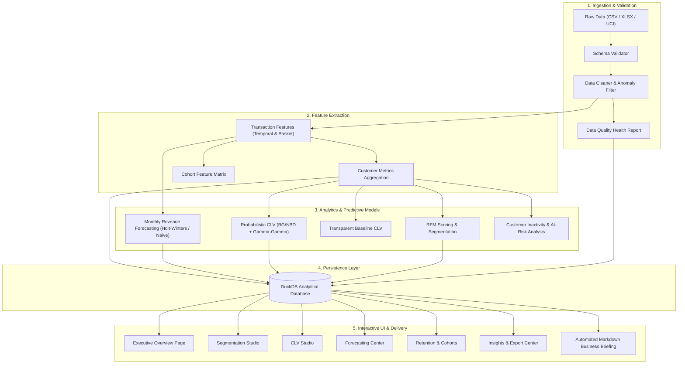

# Customer Lifetime Value (CLV) & Revenue Forecasting Engine

An end-to-end, production-grade business intelligence and predictive analytics platform that transforms granular transaction data into customer-level behavioral profiles, RFM segments, Customer Lifetime Value (CLV) forecasts, aggregate monthly revenue projections, and rule-based business recommendations.

---

## 1. Business Problem

Modern transactional businesses face core strategic challenges:
- **Disproportionate Customer Contribution:** Often, a small fraction of customers drives the vast majority of cumulative revenue (Pareto principle), creating high revenue concentration risk.
- **Dormancy & Silent Churn:** In non-contractual commerce, customers do not explicitly cancel; they quietly lapse into inactivity without warning.
- **Uncertain Future Cash Flows:** Finance and marketing teams struggle to project future revenue trajectories and evaluate marketing spend without rigorous, empirically validated forecasts.
- **Lack of Actionable Segmentation:** Blanket promotions erode margins and fail to engage distinct customer cohorts appropriately.

The **Customer Lifetime Value (CLV) & Revenue Forecasting Engine** bridges these gaps by providing an interpretable, reproducible analytical system that converts raw purchase logs into forward-looking decisions.

---

## 2. Project Objectives

1. **Identify High-Value Customers:** Surface top revenue contributors and isolate key account dependencies.
2. **Predict Future Customer Value:** Forecast forward transaction frequency and monetary value using probabilistic (BG/NBD + Gamma-Gamma) and transparent baseline models.
3. **Detect Inactivity & Retention Risks:** Track repeat purchase rates, construct monthly cohort decay matrices, and flag high-value at-risk accounts before permanent defection.
4. **Forecast Aggregate Monthly Revenue:** Evaluate multi-model time-series projections (Naive, Seasonal-Naive, Holt-Winters) with strictly chronological holdout testing.
5. **Generate Evidence-Backed Actions:** Automate strategic recommendations backed by observed metrics, explicit decision rules, suggested initiatives, and business limitations.

---

## 3. System Architecture



---

## 4. Technology Stack

- **Core Runtime:** Python 3.11 / 3.12 / 3.14 (Ubuntu Linux)
- **Data Processing & Scientific Computing:** Pandas 2.2+, NumPy 1.26+, SciPy 1.12+
- **Machine Learning & Modeling:** Scikit-learn 1.4+, Statsmodels 0.14+ (Holt-Winters Exponential Smoothing)
- **Probabilistic CLV Modeling:** Lifetimes 0.11.3 (Beta-Geometric / Negative Binomial Distribution + Gamma-Gamma)
- **Analytical Storage:** DuckDB (Default high-performance embedded OLAP database) with zero-configuration SQLite fallback
- **Interactive Visualization:** Streamlit 1.35+, Plotly 5.20+
- **Quality Assurance & Testing:** Pytest 8.0+

---

## 5. Repository Structure

```
customer-lifetime-value-forecasting/
├── app.py                         # Main Streamlit interactive dashboard entrypoint
├── requirements.txt               # Pinned, tested Python dependencies
├── README.md                      # Comprehensive project documentation
├── .gitignore                     # Git hygiene exclusions
├── .env.example                   # Environment configuration template
├── config/
│   ├── __init__.py
│   ├── settings.py                # Centralized paths, schemas, and hyperparameters
│   └── logging_config.py          # Formatted stream and file logging utility
├── data/
│   ├── raw/                       # Uploaded or downloaded raw retail files
│   ├── processed/                 # Staged intermediate datasets
│   └── synthetic/                 # Deterministic synthetic retail datasets
├── database/
│   ├── __init__.py
│   ├── db_manager.py              # Analytical database abstraction (DuckDB / SQLite / Postgres)
│   └── schema.sql                 # DDL definitions for analytical tables
├── src/
│   ├── __init__.py
│   ├── ingestion/
│   │   ├── __init__.py
│   │   ├── loader.py              # File loading, UCI downloader, provenance tracking
│   │   └── schema_validator.py    # Schema verification and column alias mapping
│   ├── preprocessing/
│   │   ├── __init__.py
│   │   ├── cleaner.py             # Deduplication, cancellation/return isolation, cleaning
│   │   └── data_quality.py        # Standardized Data Quality Health Score calculation
│   ├── features/
│   │   ├── __init__.py
│   │   ├── transaction_features.py# Calendar and basket-level feature extraction
│   │   ├── customer_features.py   # Customer-level aggregations (AOV, recency, lifespan)
│   │   └── cohort_features.py     # Monthly acquisition cohort matrices
│   ├── segmentation/
│   │   ├── __init__.py
│   │   └── rfm.py                 # Quantile RFM scoring and business segment mapping
│   ├── clv/
│   │   ├── __init__.py
│   │   ├── baseline.py            # Historical baseline & transparent forecast CLV
│   │   ├── probabilistic.py       # BG/NBD + Gamma-Gamma with fallback logic
│   │   └── evaluation.py          # Distribution metrics and model comparisons
│   ├── forecasting/
│   │   ├── __init__.py
│   │   ├── revenue_forecast.py    # Chronological split, Holt-Winters, Naive baselines
│   │   └── evaluation.py          # Time-series metrics (MAE, RMSE, WAPE, MAPE)
│   ├── retention/
│   │   ├── __init__.py
│   │   └── retention_analysis.py  # Repeat rates, inactivity buckets, at-risk flags
│   ├── recommendations/
│   │   ├── __init__.py
│   │   └── rules.py               # 4-part rule-based strategic recommendation engine
│   ├── pipeline/
│   │   ├── __init__.py
│   │   └── orchestrator.py        # End-to-end modular pipeline orchestrator
│   └── reporting/
│       ├── __init__.py
│       └── report_generator.py    # Automated executive Markdown report compiler
├── ui/
│   ├── __init__.py
│   ├── overview.py                # Page 1: Executive Overview
│   ├── segmentation.py            # Page 2: Customer Segmentation
│   ├── clv_studio.py              # Page 3: CLV Prediction Studio
│   ├── forecasting.py             # Page 4: Revenue Forecasting
│   ├── retention.py               # Page 5: Retention & Cohort Dynamics
│   ├── data_quality.py            # Page 6: Data Quality & Ingestion Center
│   └── insights.py                # Page 7: Insights & Export Center
├── sql/
│   └── analytics.sql              # Reusable parameterized SQL analytical queries
├── tests/
│   ├── __init__.py
│   ├── conftest.py                # Controlled pytest fixtures
│   ├── test_loader.py             # Ingestion & schema validation tests
│   ├── test_cleaner.py            # Data cleaning & DQ audit tests
│   ├── test_rfm.py                # RFM scoring & segment classification tests
│   ├── test_clv.py                # CLV baseline & probabilistic model tests
│   ├── test_forecasting.py        # Time-series forecasting & metric tests
│   ├── test_database.py           # DuckDB & SQLite persistence tests
│   └── test_pipeline.py           # End-to-end integration tests
├── scripts/
│   ├── __init__.py
│   ├── generate_synthetic_data.py # Deterministic synthetic dataset generator
│   └── run_pipeline.py            # CLI pipeline execution script
├── reports/                       # Generated executive business reports
└── logs/                          # Persistent application log files
```

---

## 6. Dataset Sources & Governance

### Preferred Public Dataset: UCI Online Retail
- **Source:** [UCI Machine Learning Repository: Online Retail Dataset](https://archive.ics.uci.edu/dataset/352/online+retail)
- **Description:** Real non-store online retail transactions recorded between December 2010 and December 2011 for a UK-based registered giftware retailer.
- **Attributes:** `InvoiceNo`, `StockCode`, `Description`, `Quantity`, `InvoiceDate`, `UnitPrice`, `CustomerID`, `Country`.
- **Note:** This dataset represents wholesale and retail gift sales and may exhibit customer purchasing patterns unique to seasonal gift merchandise.

### Deterministic Synthetic Dataset Generator
- Built-in generator (`scripts/generate_synthetic_data.py`) creating realistic transactional data with intentional, calibrated anomalies:
  - Cancellations/returns indicated by `C` invoice prefix and negative quantities (~4%).
  - Guest checkouts with missing `CustomerID` (~5%).
  - Duplicate transaction rows (~1.5%).
  - Zero/invalid unit prices (~0.3%).
  - Corrupted date strings (~0.1%).
- **Fixed Seed:** Deterministic generation (`seed=42`) ensures full reproducibility.
- **Provenance Labeling:** The UI, logs, and database explicitly display an active warning when synthetic data is loaded.

---

## 7. Data Cleaning Policy & Data Quality Health

The cleaning engine enforces explicit, auditable policies:
1. **Deduplication:** Identifies and drops exact duplicated rows.
2. **Customer Identification:** For customer-level behavioral modeling, records without a valid `CustomerID` cannot be assigned to an account and are excluded from customer metrics (tracked in DQ audit). Trailing `.0` on float IDs is stripped.
3. **Returns and Cancellations:** Invoices with a `C` prefix or negative quantities are isolated into a separate `returns_df` for return rate calculations, preventing distortion of positive sales volume.
4. **Price and Quantity Constraints:** Requires `UnitPrice > 0` and `Quantity > 0` for primary sales modeling.
5. **Timestamp Normalization:** Converts unparseable date records to `NaT` and drops them.
6. **Data Quality Score:** Evaluated as:
   $$\text{DQ Health Score} = \left(\frac{\text{Cleaned Valid Sales Rows}}{\text{Total Raw Ingested Rows}}\right) \times 100$$

---

## 8. Analytical Methodologies

### A. RFM Segmentation
- **Recency ($R$):** Days elapsed between the customer's last purchase and reference cutoff. Lowest recency receives the highest score ($R=5$).
- **Frequency ($F$):** Total count of distinct orders/invoices placed. Highest frequency receives $F=5$.
- **Monetary ($M$):** Cumulative spending across all valid invoices. Highest spending receives $M=5$.
- **Quantile Scoring:** Implemented with rank-based percentiles to prevent bin collapse on tied values (e.g., numerous single-order customers).
- **Segment Definitions:**
  - **Champions:** $R \ge 4$ and $F \ge 4$
  - **Loyal Customers:** $R \ge 3$ and $F \ge 3$
  - **Potential Loyalists:** $R \ge 4$ and $F < 4$
  - **Recent Customers:** $R \ge 4$ and $F = 1$
  - **Customers Needing Attention:** $(R = 2 \text{ or } R = 3)$ and $F \ge 2$
  - **At-Risk Customers:** $R \le 2$ and $F \ge 3$
  - **Hibernating Customers:** $R \le 2$ and $F \le 2$

### B. Customer Lifetime Value (CLV)
1. **Probabilistic CLV (BG/NBD + Gamma-Gamma):**
   - **Frequency Model (BG/NBD):** Assumes transaction frequency follows a Poisson process with Gamma-distributed heterogeneity across customers, while customer dropout follows a Geometric process with Beta-distributed heterogeneity.
   - **Monetary Model (Gamma-Gamma):** Models average spend per transaction assuming transaction values follow a Gamma distribution. Assumes independence between transaction frequency and monetary value (verified via Pearson correlation test).
   - **Automatic Fallback:** If repeat customers $< 10$ or numerical optimization fails, the system automatically falls back to the Transparent Baseline model with clear diagnostic labeling.
2. **Transparent Forecast Baseline:**
   $$\text{Activity Weight} = \exp\left(-\frac{\text{recency\_days}}{180}\right)$$
   $$\text{Expected Transactions} = \text{monthly\_frequency} \times \text{horizon\_months} \times \text{Activity Weight}$$
   $$\text{Predicted CLV} = \frac{\text{Expected Transactions} \times \text{AOV} \times \text{Gross Margin}}{1 + \text{Discount Rate} \times (\text{horizon\_months} / 12)}$$
3. **Historical Baseline:**
   Annualizes observed historical revenue based on active customer lifespan and discounts across the horizon.

### C. Monthly Revenue Forecasting
- **Chronological Validation:** Uses strict chronological train/test splitting (e.g., latest 3 months held out). Time-series observations are never randomly shuffled.
- **Models:**
  1. *Naive Baseline:* Projects the most recently observed period forward.
  2. *Seasonal-Naive:* Repeats observations from 12 months prior (requires $\ge 24$ months of history).
  3. *Holt-Winters Exponential Smoothing:* Captures level and additive trend with defensible 95% prediction intervals derived from residual variance:
     $$\hat{y}_{t+h} \pm 1.96 \cdot \sigma_{\text{residuals}}$$
- **Evaluation Metrics:**
  - Mean Absolute Error (MAE)
  - Root Mean Squared Error (RMSE)
  - Weighted Absolute Percentage Error (WAPE):
    $$\text{WAPE} = \frac{\sum |y_t - \hat{y}_t|}{\sum |y_t|} \times 100\%$$
  - Mean Absolute Percentage Error (MAPE) with zero-actual filtering.

### D. Retention & Inactivity Analysis
- **Monthly Cohort Heatmap:** Tracks percentage retention across acquisition cohorts over normalized monthly indices ($0, 1, 2, \dots$).
- **Inactivity Buckets:** Categorizes accounts into operational recency intervals (Active 0–30d, Cooling Down 31–90d, Warm Inactive 91–180d, Dormant 181–365d, Lapsed >365d).
- **Heuristic Inactivity Alerts:** Flags high-value accounts exceeding 90 days dormancy with tailored retention actions.

### E. Evidence-Backed Recommendation Rules
Every automated recommendation contains four explicit pillars:
1. **Observed Evidence:** Concrete empirical finding (e.g., "Top 10% customers generate 64.2% of total revenue").
2. **Trigger Rule:** Documented threshold (e.g., "Top decile concentration exceeds 50.0%").
3. **Suggested Action:** Prescriptive initiative (e.g., "Deploy VIP loyalty perks and dedicated account monitoring").
4. **Strategic Limitation:** Explicit boundary condition or trade-off (e.g., "Does not account for margin elasticity or price sensitivity").

---

## 9. Analytical Database Schema

The default analytical database is DuckDB (`database/clv_engine.duckdb`), with automatic SQLite fallback (`database/clv_engine.sqlite`):

- `pipeline_metadata`: Audit records of pipeline execution runs, execution duration, and dataset provenance.
- `data_quality_reports`: Total rows, excluded anomalies, duplicate counts, and health scores.
- `raw_transactions`: Staged ingested transactions.
- `cleaned_transactions`: Validated transactions with computed total amounts and return flags.
- `customer_metrics`: Granular customer-level aggregations (AOV, recency, lifespan, frequency).
- `rfm_segments`: Customer segment assignments and composite scores.
- `clv_predictions`: Predicted future transactions, revenue, and net present value.
- `revenue_forecasts`: Historical actuals, holdout comparisons, and future monthly projections.

---

## 10. Installation & Quickstart Guide

### Prerequisites
- Ubuntu Linux (or any modern Linux / macOS distribution)
- Python 3.11, 3.12, or 3.14
- 16 GB RAM recommended (project runs comfortably on < 2 GB RAM)

### Step 1: Clone the Repository
```bash
git clone <repository_url> customer-lifetime-value-forecasting
cd customer-lifetime-value-forecasting
```

### Step 2: Create and Activate Virtual Environment
```bash
python3 -m venv .venv
source .venv/bin/activate
```

### Step 3: Install Dependencies
```bash
pip install --upgrade pip
pip install -r requirements.txt
```

### Step 4: Configure Environment (Optional)
```bash
cp .env.example .env
# Edit .env to adjust default database backend (duckdb/sqlite), horizons, or discount rates
```

### Step 5: Generate Benchmark Synthetic Dataset (If no external data)
```bash
python scripts/generate_synthetic_data.py --customers 400 --invoices 2500 --seed 42
```

### Step 6: Run Automated Tests
```bash
pytest -v tests/
```

### Step 7: Launch the Interactive Dashboard
```bash
streamlit run app.py
```
Access the application in your browser at `http://localhost:8501`.

---

## 11. Command-Line Pipeline Execution

You can run the entire analytical pipeline directly from the command line:
```bash
# Run pipeline with default DuckDB backend and 12-month CLV horizon
python scripts/run_pipeline.py

# Run pipeline on a specific dataset with custom profit margin (e.g., 40%)
python scripts/run_pipeline.py --source data/raw/Online_Retail.xlsx --margin 0.40 --forecast-horizon 6
```

---

## 12. Model Governance & Limitations

- **Non-Contractual Inactivity:** Without contractual cancellation events, churn cannot be observed directly. Inactivity thresholds (> 90 days) serve as operational heuristics, not causal churn models.
- **Wholesale / Bulk Distortions:** The UCI Online Retail dataset contains bulk wholesale orders alongside retail consumer purchases. A small number of wholesale buyers skew average order values.
- **Short Time-Series Horizon:** For datasets with fewer than 24 months of history, multi-year seasonality cannot be verified statistically; seasonal-naive projections reflect annual repeats rather than estimated harmonic seasonality.
- **Gross Margin Assumptions:** Unless actual product cost data is supplied, revenue-based CLV assumes 100% gross margin. Users can configure the margin parameter to reflect true unit economics.

---

## 13. Privacy, Security & Git Hygiene

- No API keys, credentials, or proprietary tokens are required or committed.
- Local DuckDB databases, SQLite files, logs, and virtual environments are explicitly excluded in `.gitignore`.
- Synthetic data generation uses deterministic pseudorandom generators (`np.random.default_rng(seed)`), containing zero actual consumer personally identifiable information (PII).
